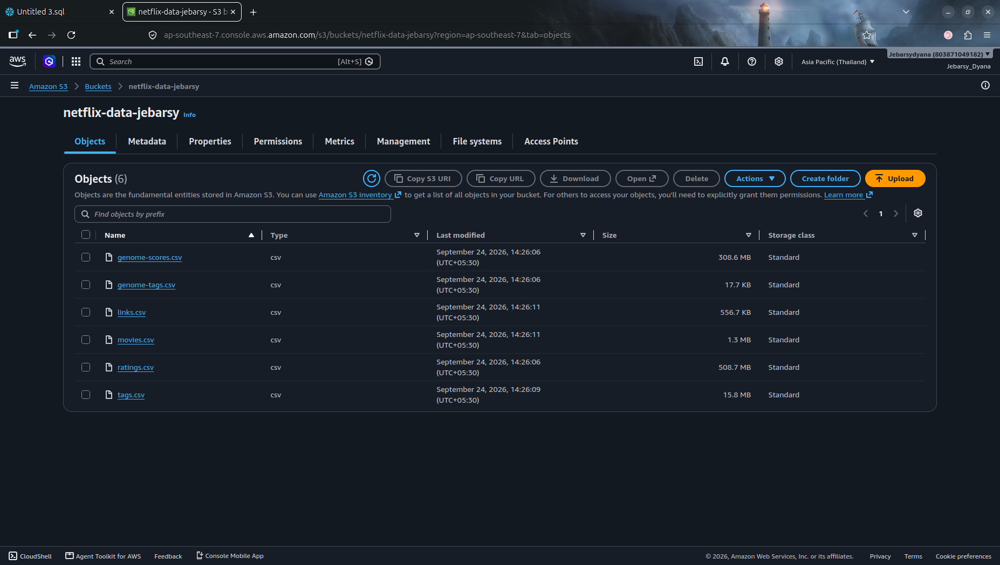
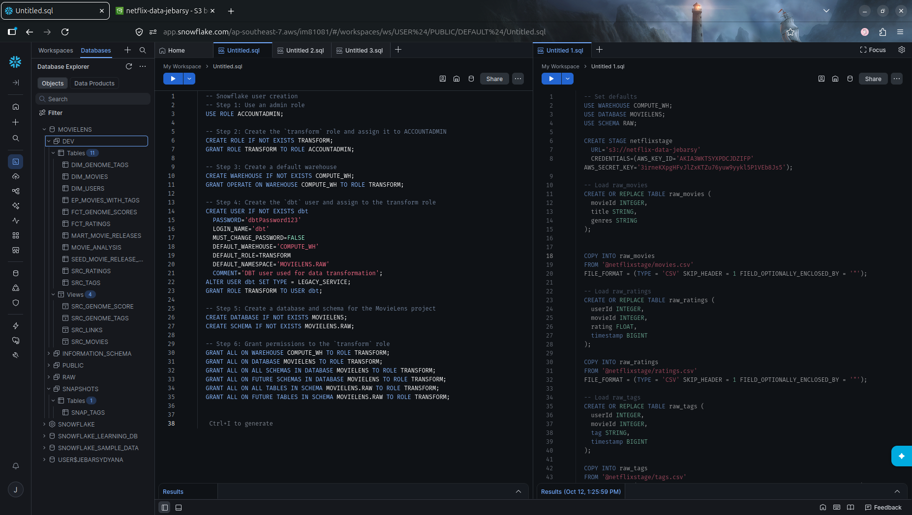
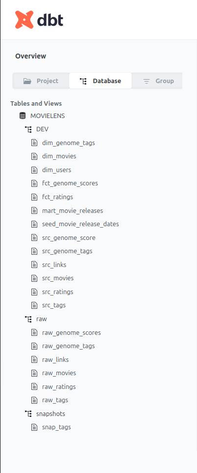
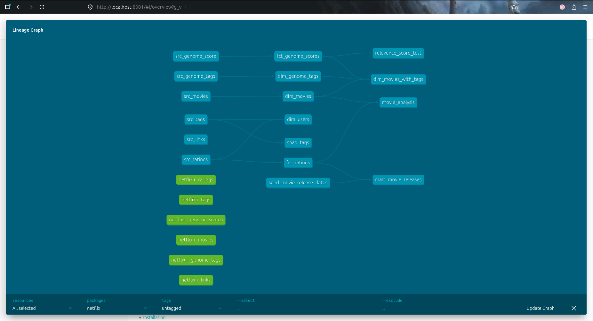

# Movie Data Analysis with dbt, Snowflake & AWS S3

A hands-on data engineering project completed while following Darshil Parmar's end-to-end dbt tutorial. I worked through setting up cloud storage and a Snowflake warehouse, configuring a dbt project, organizing SQL models, and exploring dbt features for testing, snapshots, macros, and documentation.

> **Dataset note:** The repository is named `Netflix-Analysis-DBT`, but the database overview screenshot shows a `MOVIELENS` database and objects such as `dim_movies`, `dim_users`, and `fct_ratings`. This README therefore describes the movie-data workflow shown in the project. Confirm the source dataset before describing it specifically as Netflix data.

## What I worked on

- Set up an AWS S3 bucket for project data files.
- Set up and explored a Snowflake environment for storing and querying data.
- Wrote and ran Snowflake SQL scripts as part of the warehouse setup.
- Set up a dbt Core project and its project/package configuration.
- Organized the dbt project into models, seeds, snapshots, macros, analyses, and tests.
- Worked with source definitions and seed data.
- Explored snapshot configuration to track changes to records over time.
- Worked with dbt tests to validate configured data expectations.
- Generated and viewed dbt documentation locally.
- Reviewed the dbt lineage graph and the database overview to understand the resulting data objects and dependencies.

## Tools and technologies

| Tool | How I used it in this project |
|---|---|
| AWS S3 | Cloud storage for project data files |
| Snowflake | Data warehouse and SQL execution environment |
| dbt Core | SQL transformation project and model organization |
| SQL | Warehouse setup and data transformations |
| YAML | dbt project and resource configuration |
| Jinja / dbt macros | Reusable transformation logic where implemented |
| Git and GitHub | Version control and project hosting |

## Workflow

The workflow I explored connects cloud storage, the data warehouse, and dbt transformations:

```text
Project data files
       |
       v
    AWS S3
       |
       v
   Snowflake
       |
       v
   dbt project
   ├── Models
   ├── Sources
   ├── Seeds
   ├── Snapshots
   ├── Macros
   └── Tests
       |
       v
Documented warehouse objects and model lineage
```

This is a high-level view of the workflow. The exact ingestion mechanism and dependencies are defined by the SQL scripts and dbt configuration in the repository.

## Project structure

```text
DBT_Netflix_Project/
├── Screenshot-Demo/       # Screenshots of AWS, Snowflake, and dbt
├── docs/                  # Project documentation
├── netflix/               # dbt project
│   ├── analyses/
│   ├── dbt_packages/
│   ├── logs/
│   ├── macros/
│   ├── models/
│   ├── seeds/
│   ├── snapshots/
│   ├── target/
│   ├── tests/
│   ├── dbt_project.yml
│   ├── packages.yml
│   └── package-lock.yml
├── snowflake/              # Snowflake SQL scripts
│   ├── 1.sql
│   ├── 2.sql
│   └── 3.sql
├── .gitignore
└── README.md
```

Generated folders such as `logs/`, `target/`, and `dbt_packages/` may be created while running dbt; they are not the primary source files for the project.

## Data objects explored

The dbt database overview screenshot displays objects including:

- **Dimension objects:** `dim_movies`, `dim_users`
- **Fact object:** `fct_ratings`
- **Source objects:** `src_movies`, `src_ratings`, `src_tags`, `src_links`, `src_genome_score`, `src_genome_tags`
- **Raw objects:** `raw_movies`, `raw_ratings`, `raw_tags`, `raw_links`, `raw_genome_scores`, `raw_genome_tags`
- **Additional objects:** `fct_genome_scores`, `mart_movie_releases`, `mart_movie_release_dates`, and `seed_movie_release_dates`
- **Snapshot shown:** `snap_tags`

These names are taken from the project screenshot. Refer to the SQL and YAML files for the exact transformations, model materializations, and relationships.

## Screenshots

The `Screenshot-Demo/` directory contains visual evidence from the project, including the AWS S3 bucket, Snowflake, dbt database overview, and lineage graph.

If the screenshot filenames match the names below, GitHub will display them here. Update a path if your local filename differs.

### AWS S3



### Snowflake



### dbt database overview



### dbt lineage graph



## Run the dbt project

These are the general commands I used to work with the dbt project. They assume that Python, dbt, project dependencies, and a valid Snowflake profile are configured.

### 1. Clone the repository

```bash
git clone https://github.com/Jebarsydyana/Netflix-Analysis-DBT.git
cd Netflix-Analysis-DBT/netflix
```

### 2. Set up the environment

Create a virtual environment if needed:

```bash
python3 -m venv .venv
source .venv/bin/activate
```

Install the Snowflake adapter if it is not already installed:

```bash
pip install dbt-snowflake
```

### 3. Configure and verify Snowflake access

Configure your local dbt profile for your Snowflake account. Keep credentials in local configuration or environment variables—never commit passwords, access keys, or tokens.

```bash
dbt debug
```

### 4. Install dbt packages

```bash
dbt deps
```

### 5. Run models and tests

```bash
dbt run
dbt test
```

### 6. Generate and view documentation

```bash
dbt docs generate
dbt docs serve
```

Open the local URL printed by dbt. If the default port is already in use, stop the existing process or choose another available port.

## What I learned

By completing this tutorial-based project, I gained practical exposure to:

- Connecting cloud storage and a cloud data warehouse in a data engineering workflow.
- Working with Snowflake SQL scripts.
- Structuring a dbt project and its configuration.
- Organizing data objects into raw, source, dimension, fact, and mart-style layers where represented in the project.
- Using dbt seeds, sources, snapshots, tests, and macros.
- Generating documentation and reviewing lineage.
- Managing a project with Git and publishing it on GitHub.

## Learning resource

I followed this tutorial as the learning resource for the project:

**Darshil Parmar — Netflix Data Analysis | DBT (data build tool) Tutorial Course | End-To-End Project**

[Watch the tutorial on YouTube](https://youtu.be/zZVQluYDwYY)

This repository documents my hands-on learning and implementation based on the tutorial.

## Author

**Jebarsy Dyana**  
[GitHub profile](https://github.com/Jebarsydyana)